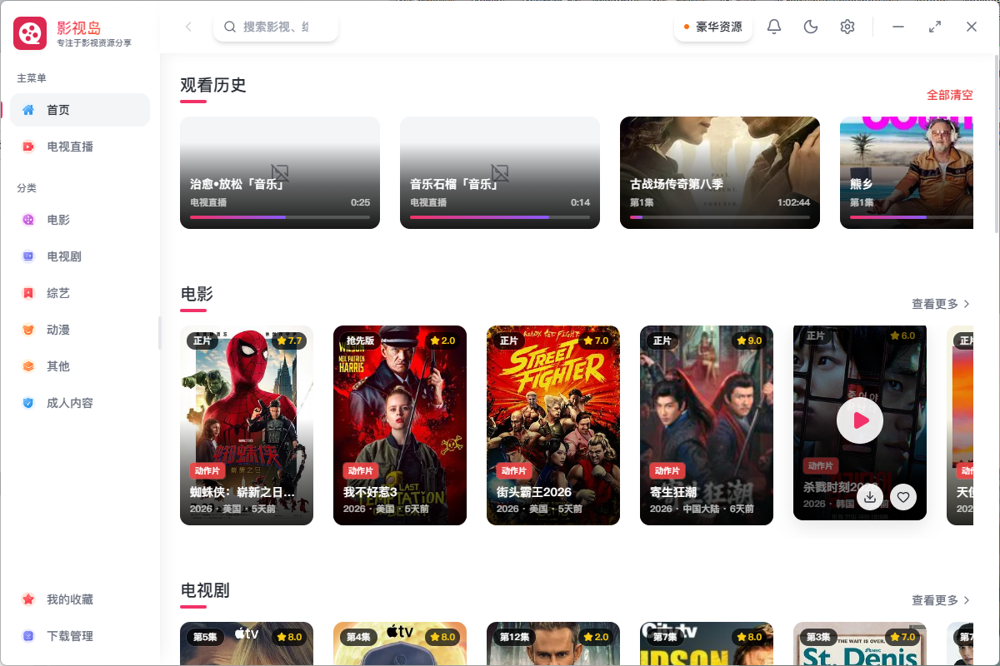
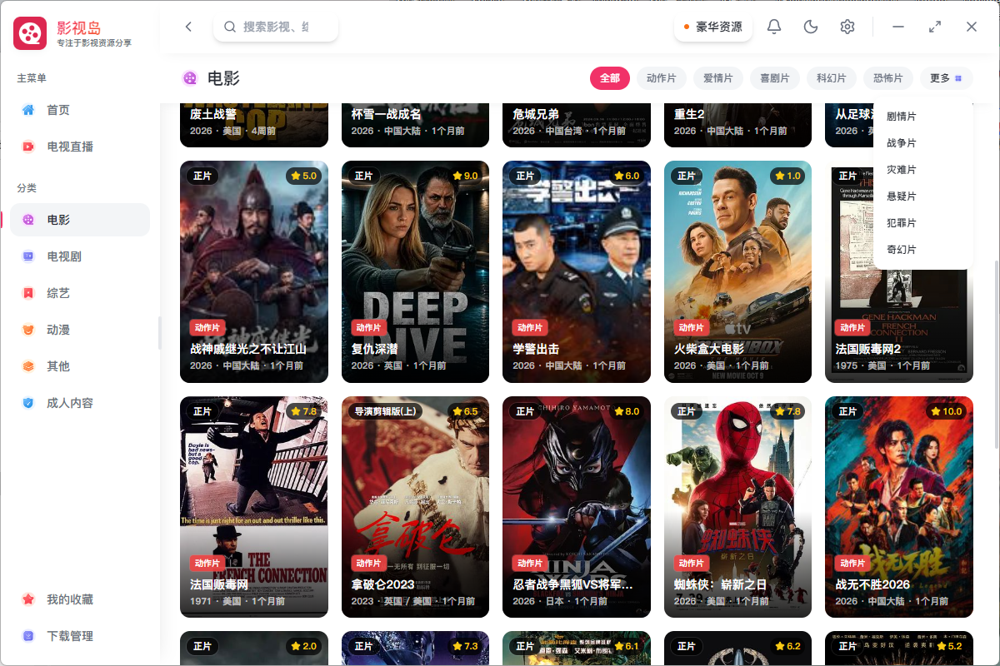
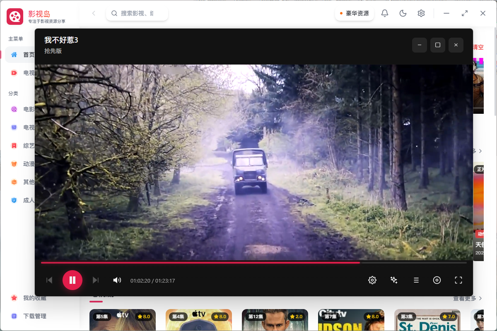
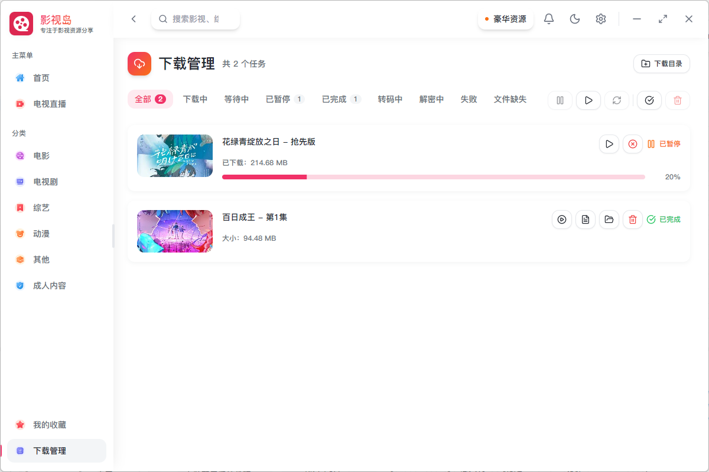

# 影视岛 (imedia-video)

> 专注于影视资源分享的桌面客户端，基于 Electron 构建。

[](https://github.com/legend0/imedia-video-desktop/releases)
[](LICENSE)

仓库地址：[https://github.com/legend0/imedia-video-desktop](https://github.com/legend0/imedia-video-desktop)

## 简介

影视岛是一款开源的影视资源聚合播放客户端，支持多资源站订阅、在线播放、IPTV 直播与视频下载，所有数据保存在本地。

**主要特性**

- 多资源源管理：支持手动添加与订阅资源站，可用性检测，一键切换
- 在线播放：内置 HLS 播放器，支持倍速、跳过片头片尾、快捷键、自动连播
- IPTV 直播：支持 M3U8 直播源订阅
- 视频下载：基于 ffmpeg 的分段下载与合并，支持并发控制
- 媒体信息增强：可选接入 TMDB，自动展示海报、剧照与剧情简介
- 数据备份：支持通过 WebDAV 同步配置与收藏数据

## 应用截图

| 首页 | 列表 |
| --- | --- |
|  |  |
| **播放器** | **下载** |
|  |  |

## 技术栈

- Electron 22 / Chromium 渲染
- React 18 + Vite + TailwindCSS（前端界面）
- hls.js / m3u8-parser / mux.js（流媒体处理）
- fluent-ffmpeg + ffmpeg（下载与转码）
- axios / cheerio / undici（网络请求与解析）

## 快速开始

### 环境要求

- Node.js 16+
- Windows 10/11（当前打包配置仅支持 Windows x64）

### 开发运行

```bash
# 启动 Electron（根目录）
npm install
npm run dev
```

> 注意：仓库不包含 `main/ffmpeg/ffmpeg.exe` 二进制（体积超过 GitHub 限制）。开发运行视频下载功能前，请自行下载 ffmpeg 并放置到 `main/ffmpeg/ffmpeg.exe`；从 [Releases](https://github.com/legend0/imedia-video-desktop/releases) 下载的安装包已内置，无需额外配置。

### 前端开发

前端工程位于 `frontend/`，修改界面后需重新构建：

```bash
cd frontend
npm install

# 开发调试（Vite 热更新）
npm run dev

# 构建产物输出到 ../view（Electron 运行时加载目录）
npm run build
```

### 构建发布

```bash
npm run build
```

构建产物输出至 `../dist` 目录。

## 订阅源（可选）

应用默认不内置任何资源源，首次使用需在「设置 → 资源源」中手动添加接口地址，或使用下方订阅地址一键导入。

**是否使用以下订阅源由您自行决定**，订阅前请了解并遵守当地法律法规：

| 类型 | 订阅地址 | 使用方式 |
| --- | --- | --- |
| 视频资源源 | `https://raw.githubusercontent.com/legend0/imedia-video-desktop/main/subscriptions/resources.json` | 设置 → 资源源 → 订阅源 |
| IPTV 直播源 | `https://raw.githubusercontent.com/legend0/imedia-video-desktop/main/subscriptions/iptv.m3u8` | 设置 → 电视直播 → 订阅更新 |

订阅文件存放在仓库 [`subscriptions/`](subscriptions/) 目录中，可自行查看内容。不使用订阅源的情况下，也可以在设置中直接添加任意资源站接口（如 `https://example.com/api.php/provide/vod/` 格式）。

## 项目结构

```
├── main/              # Electron 主进程
│   ├── core/          # 业务核心（资源源、播放、下载、备份等）
│   ├── downloaders/   # 下载器实现
│   ├── ffmpeg/        # ffmpeg 相关处理
│   ├── proxy/         # 本地代理
│   └── utils/         # 工具函数
├── frontend/          # 前端工程源码（React + Vite，构建输出至 view/）
│   ├── src/           # 页面、组件、播放器、插件
│   └── public/        # 静态资源
├── view/              # 前端构建产物（运行时加载）
├── storage/           # 应用配置（运行时生成/用户数据，不入库）
└── docs/              # 项目文档
```

## 参与贡献

欢迎提交 Issue 与 Pull Request。

## 免责声明

- 本项目仅为个人学习与研究目的开发，不存储、不上传任何影视资源
- 项目本身不内置任何内容，所有资源均来自用户自行订阅的第三方接口
- 请用户在使用过程中遵守所在国家/地区的法律法规，尊重内容版权
- 本项目不承担因使用第三方资源接口而产生的任何法律责任
- 如本项目侵犯您的权益，请通过 Issue 联系，我们将及时处理

## 开源许可

本项目基于 [MIT License](LICENSE) 开源。
